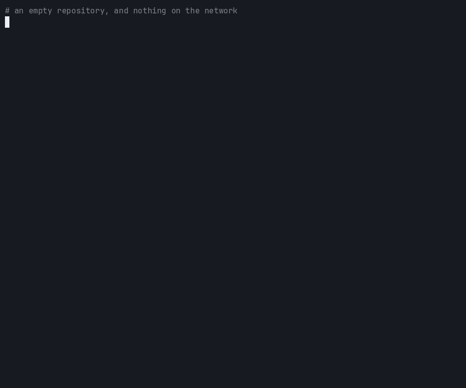
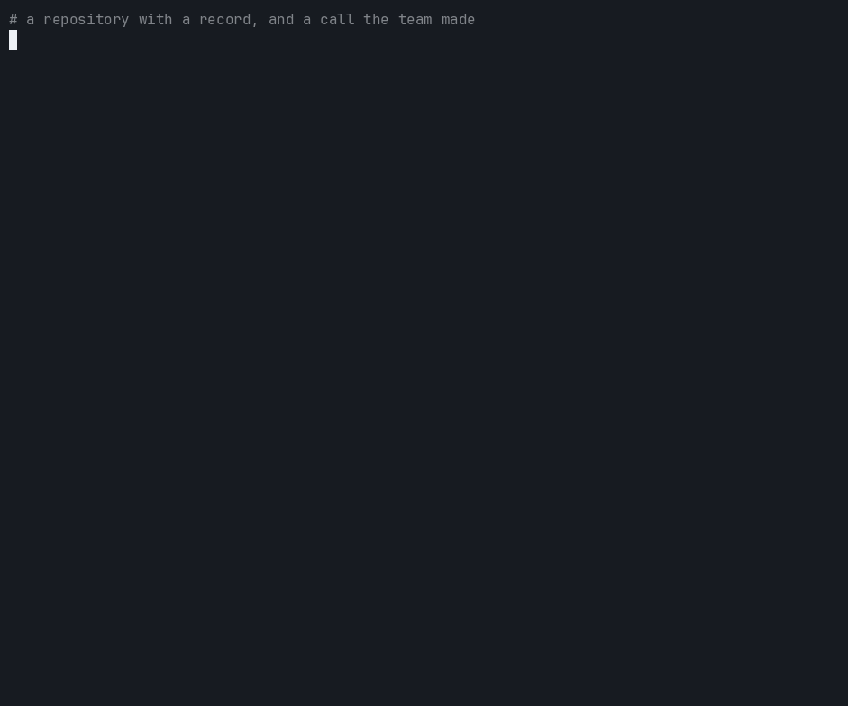
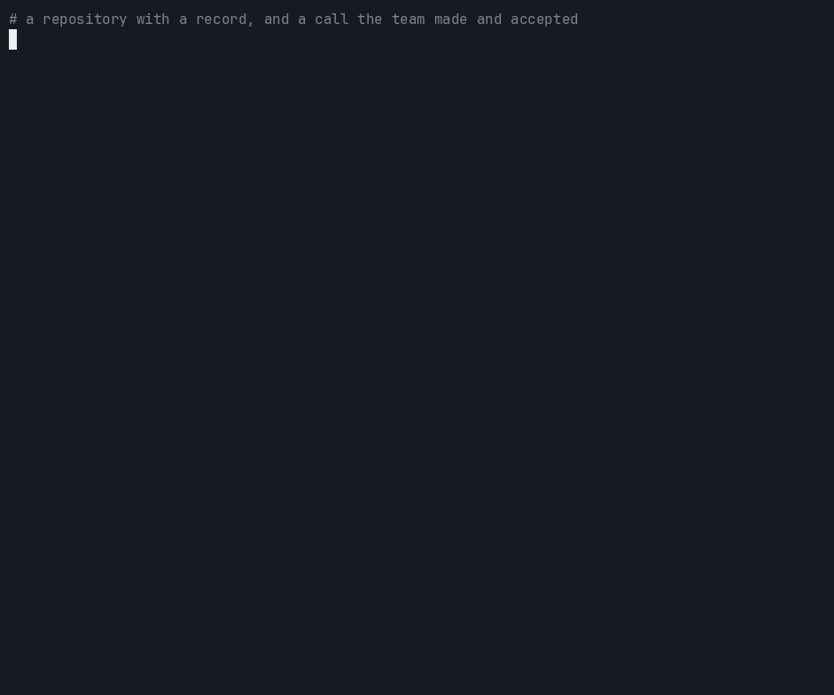

<div align="center">

<picture>
  <source media="(prefers-color-scheme: dark)" srcset="docs/assets/banner-dark.svg">
  
</picture>

<h3>mnema is the decision record for AI coding agents.</h3>

<p>
Your decisions, handed to your agents' sessions and held at the edits they govern: append-only and signed in the repository, and checkable by anyone.
</p>

<p>
<a href="https://github.com/felipesauer/mnema/actions/workflows/ci.yml"></a>
<a href="https://www.npmjs.com/package/@mnema/code"></a>
<a href="LICENSE"></a>

</p>

<picture>
  <source media="(prefers-color-scheme: dark)" srcset="docs/assets/how-mnema-fits-dark.svg">
  
</picture>

</div>

<table>
<tr>
<th align="center">Remember</th>
<th align="center">Enforce</th>
<th align="center">Prove</th>
</tr>
<tr>
<td align="center" width="33%">With the plugin, each agent session opens with the decisions in force, by name and id.</td>
<td align="center" width="33%">A rule addressed at a path can refuse an agent's write there, or hold it for a person where the host allows.</td>
<td align="center" width="33%">Every write the product makes ends in a signed checkpoint and is hash-chained; anyone can verify it, even in a browser, and a reader's guarantee runs up to the last checkpoint.</td>
</tr>
</table>

<p align="center">
Tamper-evident, not tamper-proof: what is still in the record has not changed
since it was signed, and a stranger can check that without your keys and without
installing this.
</p>

<p align="center">
<a href="#why">Why</a> · <a href="#status">Status</a> · <a href="#quick-start">Quick start</a> · <a href="#how-it-works">How it works</a> · <a href="#hosts">Hosts</a> · <a href="#the-mnema-family">Family</a> · <a href="#watch-it">Watch it</a> · <a href="#what-it-proves-and-what-it-does-not">What it proves</a> · <a href="#docs">Docs</a>
</p>

## Why

Your agents settle choices all day: a library, an approach, an option turned down. Those choices usually live in a chat
that ends, in one tool's memory or in somebody's head, where nobody can check who decided them or whether they were
changed since. mnema writes them down in the repository, next to the code, with their reasons and what was turned down.
The record is signed and only grows: a change of mind is a new entry that supersedes the old one, never an edit. Where
the host runs hooks, each session opens with the decisions in force, and anyone can check offline that what it holds
was not changed since it was signed. What is measured, and what is not, is on [the evidence page](docs/evidence.md).

## Status

- **On npm.** `@mnema/code` is published: install it with `npm i -g @mnema/code` ([`docs/install.md`](docs/install.md)); to run the `main` branch instead, see [Build from source](docs/build-from-source.md).
- **Node.** Requires Node 24.15.0 or a later 24, or 26.0.0 or later.
- **From a checkout.** The GitHub Action, the SDK and the VS Code extension are not published, and run from a clone of this repository ([Packages](docs/packages.md)).

## Quick start

```sh
npm i -g @mnema/code                              # the binary
claude plugin marketplace add felipesauer/mnema   # the plugin hands each session the record
claude plugin install mnema@mnema
cd your-repository && mnema init
mnema decision record "Keep money as integer cents" "Float sums drift; cents are exact."
mnema decision move accept <id> --note "Agreed in review."   # a decision enters proposed; accepting puts it in force
mnema verify   # reads the signed record, whatever the decisions' states; one line saying it is intact is the green
```

At a terminal, `mnema decision review` goes through what awaits a judgement one by one, with no id
to copy. `mnema init` also leaves a `README.md` and an `.editorconfig` in `.mnema/`, adds `.mnema/`
to the `.prettierignore` where the repository has one or declares prettier, and writes the mnema
instructions into `AGENTS.md` and the other files agent hosts read, naming each
(`mnema instructions --remove` takes them out). The whole install, the
other hosts and the first record, line by line, are in [`docs/install.md`](docs/install.md) and
[`docs/first-record.md`](docs/first-record.md).

## How it works

<div align="center">

<picture>
  <source media="(prefers-color-scheme: dark)" srcset="docs/assets/how-it-works-dark.svg">
  
</picture>

</div>

1. **Record.** An agent over MCP, or you at the command line, writes a decision with its reasoning and the options turned down.
2. **Rule.** A person accepts it, and `mnema link` addresses it at a path. The rule can govern that path, ask for a person there, or refuse a write.
3. **Hand over.** With the plugin, each session opens with what is in force (in Claude Code, so does each subagent), and each edit meets the rules for its file. In Claude Code, a note of the host's own memory is also copied into this machine's private tree, until you switch that off.
4. **Verify.** Every write ends in a signed checkpoint and is hash-chained; a reader's guarantee runs up to the last checkpoint. `mnema verify`, a second reader in Python, or the page `mnema site` writes checks it.

More in [`docs/how-it-works.md`](docs/how-it-works.md); what a session is handed, word for word, is in
[`docs/agent-hosts.md`](docs/agent-hosts.md), and how far each host goes is under [Hosts](#hosts).

## Hosts

mnema works with any agent host that has an MCP client, and how much more a host gets depends on
what its hooks allow, one rung at a time: (a) the MCP server and rules in a file, (b) the opening
of a session, (c) a refusal before a write, (d) a pause for a person.

<!-- The host summary below is generated from packages/code/src/host-names.ts: edit the table there. -->

| | Host | Rung | What it gets | Install |
| :---: | :--- | :---: | :--- | :--- |
| <picture><source media="(prefers-color-scheme: dark)" srcset="https://cdn.jsdelivr.net/npm/@lobehub/icons-static-png@1.97.1/dark/claudecode-color.png"></picture> | **Claude Code**<br><sub>Anthropic · terminal and editors</sub> | **(d)** | MCP server · rules file · opening · refusal · pause | [Plugin](docs/install.md#claude-code) |
|  | **VS Code**<br><sub>Microsoft · the agent of the editor</sub> | **(d)** | rules file · refusal · pause<br><sub>MCP server · opening: read once</sub> | [Plugin](docs/install.md#vs-code-and-cursor) |
| <picture><source media="(prefers-color-scheme: dark)" srcset="https://cdn.jsdelivr.net/npm/@lobehub/icons-static-png@1.97.1/dark/cursor.png"></picture> | **Cursor CLI**<br><sub>Cursor · command line</sub> | **(c)** | rules file<br><sub>MCP server · opening · refusal: read once</sub> | [Plugin](docs/install.md#vs-code-and-cursor) |
| <picture><source media="(prefers-color-scheme: dark)" srcset="https://cdn.jsdelivr.net/npm/@lobehub/icons-static-png@1.97.1/dark/codex-color.png"></picture> | **Codex**<br><sub>OpenAI · command line</sub> | **(c)** | MCP server · opening · refusal<br><sub>rules file: documented, not measured</sub> | [Plugin](docs/install.md#codex) |
| <picture><source media="(prefers-color-scheme: dark)" srcset="https://cdn.jsdelivr.net/npm/@lobehub/icons-static-png@1.97.1/dark/githubcopilot.png"></picture> | **Copilot CLI**<br><sub>GitHub · command line</sub> | **(d)** | MCP server · opening · refusal · pause<br><sub>rules file: documented, not measured</sub> | [Plugin](docs/install.md#github-copilot-cli) |
| <picture><source media="(prefers-color-scheme: dark)" srcset="https://cdn.jsdelivr.net/npm/@lobehub/icons-static-png@1.97.1/dark/opencode.png"></picture> | **OpenCode**<br><sub>Anomaly · command line</sub> | **(c)** | MCP server · opening · refusal<br><sub>rules file: documented, not measured</sub> | [Plugin](docs/install.md#opencode) |
| <picture><source media="(prefers-color-scheme: dark)" srcset="https://cdn.jsdelivr.net/npm/@lobehub/icons-static-png@1.97.1/dark/geminicli-color.png"></picture> | **Gemini CLI**<br><sub>Google · command line</sub> | **(c)** | MCP server · opening · refusal<br><sub>rules file: documented, not measured</sub> | [Plugin](docs/install.md#gemini-cli) |
| <picture><source media="(prefers-color-scheme: dark)" srcset="https://cdn.jsdelivr.net/npm/@lobehub/icons-static-png@1.97.1/dark/cursor.png"></picture> | **Cursor**<br><sub>Cursor · editor</sub> | **(a)** | MCP server · rules file<br><sub>documented, not measured</sub> | [MCP server](docs/install.md#any-other-host-with-an-mcp-client) |
| <picture><source media="(prefers-color-scheme: dark)" srcset="https://cdn.jsdelivr.net/npm/@lobehub/icons-static-png@1.97.1/dark/antigravity-color.png"></picture> | **Antigravity CLI**<br><sub>Google · command line (`agy`)</sub> | **(a)** | MCP server · rules file<br><sub>documented, not measured</sub> | [MCP server](docs/install.md#any-other-host-with-an-mcp-client) |
|  | **Factory Droid**<br><sub>Factory · command line</sub> | **(a)** | MCP server · rules file<br><sub>documented, not measured</sub> | [MCP server](docs/install.md#any-other-host-with-an-mcp-client) |
| <picture><source media="(prefers-color-scheme: dark)" srcset="https://cdn.jsdelivr.net/npm/@lobehub/icons-static-png@1.97.1/dark/qwen-color.png"></picture> | **Qwen Code**<br><sub>Qwen · command line</sub> | **(a)** | MCP server · rules file<br><sub>documented, not measured</sub> | [MCP server](docs/install.md#any-other-host-with-an-mcp-client) |
| <picture><source media="(prefers-color-scheme: dark)" srcset="https://cdn.jsdelivr.net/npm/@lobehub/icons-static-png@1.97.1/dark/goose.png"></picture> | **Goose**<br><sub>Agentic AI Foundation · desktop and command line</sub> | **(a)** | MCP server · rules file<br><sub>documented, not measured</sub> | [MCP server](docs/install.md#any-other-host-with-an-mcp-client) |

<!-- End of the generated host summary. -->

Each cell of the full table, how each one is known (held by a test, read once on a real host, or
documented and not measured), and the notes on each host are in
[How each claim is held](docs/evidence.md#each-hosts-rung).

## The mnema family

<div align="center">

<picture>
  <source media="(prefers-color-scheme: dark)" srcset="https://raw.githubusercontent.com/felipesauer/mnema/main/docs/assets/the-family-dark.svg">
  
</picture>

</div>

`@mnema/code` holds the record, and the command line and the MCP server that read and write it. The rest stand around
it. The detail of most of them is in [Features](docs/features.md); for the rest, the Link column leads to the page that has it.

| Product | What it is for | Status | Link |
|---|---|---|---|
| **`@mnema/code`**<br><sub>the core</sub> | The signed, append-only record, with the command line and the MCP server over it. | `npm i -g @mnema/code` ([Install](docs/install.md)). | [Package](packages/code/README.md) |
| **GitHub Action** | On a pull request, comments what the change does to the record and fails the check when it is not signed. | Not published; runs from a clone of this repository. | [Package](packages/action/README.md) |
| **SDK** | A library door to the record, for a program that records, reads and verifies. | Not published; runs from a clone of this repository. | [Package](packages/sdk/README.md) |
| **VS Code extension** | Shows the rules in force over the open file and the decisions waiting for a judgment. | Not published; runs from a clone of this repository. | [Package](packages/vscode/README.md) |
| **Stacks** | Installs a set of skills and agents from a plan shown whole, and records the adoption as a signed fact. | Commands of `mnema`, not a package of their own; the contract they check against, `@mnema/stacks`, ships with `@mnema/code`. | [Stacks](packages/stacks/README.md) |
| **An agent in CI** | A pipeline's agent records with a key of its own, so what it records is signed as that agent. | A recipe, not a package. | [The recipe](packages/action/README.md#an-agent-in-ci) |
| **A page that verifies itself** | `mnema site` writes one HTML file, and the reader's browser checks it. | A command of `@mnema/code`, not a package. | [The page](docs/site.md) |

## Watch it

<table>
<tr>
<td width="50%" valign="top"><br><sub>The first record: the command line in an empty repository, from <code>init</code> to <code>verify</code>. Recorded from the built binary by <a href="recordings/first-record.sh"><code>recordings/first-record.sh</code></a>.</sub></td>
<td width="50%" valign="top"><br><sub>At a terminal, <code>mnema</code> alone asks what you want to do here, and its first door opens the console: a session that reads the record and refuses to write. It needs a window at least 80 columns wide and 42 rows tall. Driven through a pseudo-terminal by <a href="recordings/console.json"><code>recordings/console.json</code></a>.</sub></td>
</tr>
<tr>
<td width="50%" valign="top"><br><sub>A write refused: the rule addressed at the path stops an agent's edit there. Recorded from the built binary by <a href="recordings/a-write-refused.sh"><code>recordings/a-write-refused.sh</code></a>.</sub></td>
<td width="50%" valign="top"><br><sub>A decision superseded: a later call takes its place, the old one leaves what the next session is handed and stays in the record. Recorded from the built binary by <a href="recordings/a-decision-superseded.sh"><code>recordings/a-decision-superseded.sh</code></a>.</sub></td>
</tr>
</table>

A case in the suite runs the scripts again against the built binary and fails when a recording no longer
shows what the binary draws, so none of them can go on showing an older product in silence
([`the-recordings-are-what-the-binary-draws.test.ts`](packages/code/tests/the-recordings-are-what-the-binary-draws.test.ts)).

## What it is not

Each of these is a choice with a reason, and the reasons are in [Where it fits](docs/where-it-fits.md#what-it-is-not).

- **Not a semantic memory.** Search is by the words written in a record; there are no embeddings.
- **Not an agent runner.** It calls no model and runs no tool for the agent.
- **Not a copy somewhere else.** The committed record travels with the repository, and what you record privately stays on this machine, apart from the notes your agent's host receives, when a session opens through the plugin and when the agent asks for them, which the host sends to its model; the witness verbs send a digest out, and with Sigstore the identity too, only when you run them.
- **Not access control.** The gate refuses an illegal move; it does not decide who may write.

## What it proves, and what it does not

`mnema verify` reads the events and the committed public keys of a project's trees (no private
key, no network) and prints each verdict verbatim, naming the level it reached.

- **What holds.** A changed or reordered event breaks the hash chain, and an edit made without the signing key fails the signed checkpoints.
- **What does not hold.** Nothing proves that nothing was removed: a hash chain shows what changed, never what is gone, and the history a git remote keeps is what covers omission. A record forged whole under a fresh key verifies clean, a key is not proven to be the person a name says, and the agent named on a fact is the name its client announced, unless an agent key signed it (then the name the record enrolled the key under). A refusal of a write covers a host's editing tools, not its shell: `sed -i` on a protected file goes round it.
- **What a green `verify` means.** That nothing *verifiable* is broken, not that the record is honest, and the gate protects the shape of a change, not who may make it.

The whole table, claim by claim, is in [`docs/what-it-proves.md`](docs/what-it-proves.md); how each
claim about the agent hosts is held, and which are not held yet, is in [`docs/evidence.md`](docs/evidence.md).

## Docs

- **Use.** [Install](docs/install.md) · [Your first record](docs/first-record.md) · [How it works](docs/how-it-works.md) ·
  [What a session is handed](docs/agent-hosts.md) · [Features](docs/features.md) · [The command reference](docs/cli-reference.md) ·
  [Where it fits](docs/where-it-fits.md) · [Glossary](docs/glossary.md)
- **Verify.** [What it proves](docs/what-it-proves.md) · [How each claim is held](docs/evidence.md) ·
  [Verify without installing](docs/verify-without-installing.md) · [The page that verifies itself](docs/site.md) ·
  [When two machines disagree](docs/convergence.md) · [The record format](packages/chain/FORMAT.md)
- **Integrate.** [Packages](docs/packages.md) · [SDK](packages/sdk/README.md) · [GitHub Action](packages/action/README.md) ·
  [VS Code extension](packages/vscode/README.md) · [Stacks](packages/stacks/README.md) · [The plugin](plugin/README.md) ·
  [Porting it to a host](plugin/porting-to-a-host.md)
- **Contribute.** [Contributing](CONTRIBUTING.md) · [Build from source](docs/build-from-source.md) ·
  [Security policy](SECURITY.md) · [Changelog](CHANGELOG.md)

## License

Apache-2.0. See [`LICENSE`](LICENSE) and [`NOTICE`](NOTICE).
