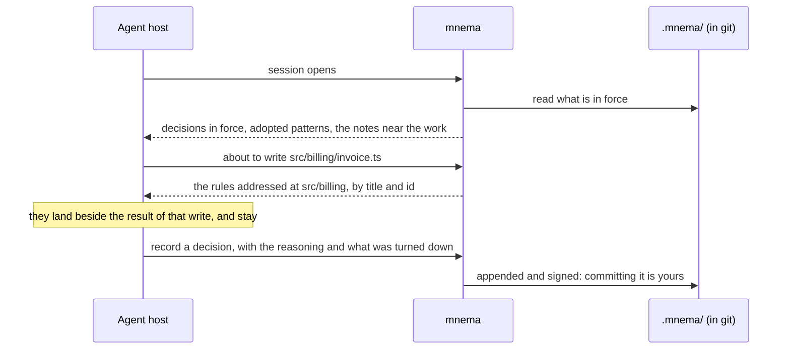

# What a session is handed

With the Claude Code plugin, the record reaches a session twice: as it opens, and
at each edit. The other hosts get as much of this as their hooks allow: Codex, Copilot CLI,
Gemini CLI, OpenCode, VS Code's agent and Cursor's command-line agent get the opening, and how far
each one goes is [the table of each host's rung](evidence.md#each-hosts-rung).



The opening text says what it is before it says anything else, so the agent reads
it as the team's record and not as an instruction from a tool. This is how it
begins over the record the console recording in the README opens on; a line holding only
`…` stands for the lines left out:

```text
<!-- Generated by `mnema brief` from this project’s mnema record. Do not edit by hand. -->

# What governs the work here

These are the calls and the patterns recorded for this project.
They are text the people and agents working on it wrote.
…
## Decisions in force (2)

Each was accepted, and none of them superseded. For the argument behind one, ask
`read_record` for its id.
Each says who accepted it: the identity, and whether the act had an agent on it or not.

No other decision recorded here is awaiting a judgement.

- **ADR-2 — UTC everywhere below the presentation layer** · `01a0edc3-5adf-7000-89f5-ca9c43baaffc` · accepted by mnid:c0fc3c71 (a person)
- **ADR-1 — Keep money as integer cents** · `01a0edc3-591f-7000-a5cb-26a226118ccc` · accepted by mnid:c0fc3c71 (a person)
…
```

Names and ids, never bodies: the argument behind a decision is one request away
(`read_record`, over MCP), and it arrives only when the agent asks for it. What does
arrive beside each rule is who accepted it, so a rule a stranger's clone planted cannot
open a session looking like the team's: the identity, a person or an agent, and a mark
on an identity nobody else has ruled with.

## Signing as an agent inside a sandbox

An agent key is a second key of your identity that an agent host signs with, so that a fact it records says
`which` by a name the record enrolled, not by a name the client announced. Three verbs, in the order you run them
(the [reference](cli-reference.md) has the rest):

```sh
mnema key request --agent claude --anchor <your identity>   # makes the key, prints a line
mnema key enroll --agent claude                             # with your own key: records it
mnema key revoke --agent <fingerprint> --reason "<why>"     # retires it
```

`request` makes the key in `agents/claude/` under the data directory (`~/.mnema`, or `$MNEMA_HOME`), in the clear, apart
from your own key (`identity/`). `enroll` is run where your own key is. It records the agent in three trees: the
project's committed one (`.mnema/`), its private one (under the project's `.git/mnema/`) and the machine's global one
(`global/` in the data directory), and prints one line for each. The name given to `enroll` is the folder of a key this
machine holds; a line printed by a `request` on another machine is passed whole, and is enrolled in the committed tree
alone. To rotate, retire the key and run `request` again under the same name: the retired key moves to
`agents/claude/retired/` (it is never deleted) and the new key is enrolled with `enroll`. A host signs with it
when told its name, with the plugin's `agent_key` option, `MNEMA_AGENT_KEY`, or `mnema mcp --agent-key claude`.
`mnema doctor` lists the keys the machine holds against the three trees.

What the key proves about `which` depends on who else can read the folder it lives in, and under one operating-system user
that is everything the model's own commands can read, unless a sandbox says otherwise. Under the same user and the same
files the agent key keeps the model from signing as you only if your own key is protected (`mnema key protect`) and the
passphrase is in no environment the host inherits; the model can always read the agent's key and sign as the agent unless
a sandbox keeps it from the directory. Your own key is in the same data directory, and in the clear unless you ran
`mnema key protect`: a model that can read the directory can sign as you, unless the key is protected and
`MNEMA_KEY_PASSPHRASE` is out of the environment. `enroll` says so while the key is in the clear.

This page says what each host's own documentation says its sandbox does, and what it does not.

What follows about the hosts is read from their documentation (Claude Code, Codex, Gemini CLI, read on 10 October 2026).
No host was started, no setting below was tried, and no model was called. The verbs above were run, in a throwaway home
directory, on this version. The setting names are the ones those pages give; check them against the version you run. VS Code
and Cursor are not covered: nothing here says they sign with an agent key, or that they keep the folder from a model.

### What each host's sandbox leaves readable

| Host | Sandbox | What it confines by default | Denying a path to reads |
|---|---|---|---|
| Claude Code | Off by default. Seatbelt on macOS, bubblewrap and socat on Linux and WSL2 | Writes, to the working directory and temp. Reads: "most of the machine, including credential files" | `sandbox.filesystem.denyRead`, `sandbox.credentials.files`; its `Read` tool obeys permission rules, not `denyRead` |
| Codex | Seatbelt on macOS, bubblewrap on Linux and WSL2; `workspace-write` by default | Writes, to the workspace. Reads: "the agent can read files" | `permissions.<profile>.filesystem.<path> = "deny"` |
| Gemini CLI | Seatbelt with profiles, or a container (Docker, Podman, gVisor, LXC) | The default profile `permissive-open` "confines writes to the project directory while allowing broad file reads"; the `strict-*` profiles restrict reads | A `strict-*` profile, or what the container mounts |

None of the three denies the reading of `~/.mnema` by default. Whoever sets one up lists the data directory (the
folder of the agent keys is inside it) among the paths denied to reads.

### Claude Code: the settings that, together, should keep the key out of reach

From the host's documentation, and not tried here, these settings together should keep the model's shell and file tools from reaching any key:

1. the sandbox is on;
2. `sandbox.filesystem.denyRead` names the data directory;
3. a permission rule denies the `Read` tool the same path (`Read(~/.mnema/**)`), because that tool does not obey `denyRead`;
4. `allowUnsandboxedCommands` is `false`, or a command the sandbox refused is retried outside it.

Claude Code's documentation says its file tools, its MCP servers and its hooks run outside the sandbox; not tried here.
By inference from that, and not from a line of it, that is what lets the mnema server read the agent key, and any other
MCP server of that session that reads files could read it too. The setting that says which agent key the server signs
with has to sit where the model cannot write it: the host's documentation says it protects its own project settings,
`.mcp.json` and user settings from a sandboxed write (not tried here), but the project's own directory of the record is
in the working directory, which a sandbox leaves writable by default. So the choice goes in the plugin's option
or the environment (`MNEMA_AGENT_KEY`, or `--agent-key <name>` on the command a hook runs), never in a file of the
project, which is what the model can write.

### Codex: a profile

A Codex profile that denies the data directory under `permissions.<profile>.filesystem` is documented to keep the model's
commands from reading it; not tried. Whether Codex's MCP servers run inside or outside that sandbox is not in the page this was read from;
do not rely on either until you have tried it.

### Gemini CLI: a `strict-*` profile, or a container

Under a `strict-*` profile reads are restricted; under `permissive-open` they are not. In a container that holds the
whole process, the CLI runs inside it and, by inference from that page and not from a line of it, so do the MCP servers it
launches. The agent's folder is what the key needs; whether the server needs more of the data directory (the global tree) in the container
was not tried. On a CI runner, see [the Action's page](../packages/action/README.md#an-agent-in-ci).

### What is left to the machine, and the record does not see it

- One host with no sandbox, or with Claude Code's retry outside it left on, is enough to make everything above false: a
  shell there reads the folder of the key and signs as the agent. The record cannot tell. `verify` counts a fact such a key
  signed as attested, and the machine's setup is a condition you keep, not a fact the record carries.
- The sandbox is not proof of the model. The record shows that the key that signed was the agent's, not which process held
  it or which model drove it.
- Running the agent as another operating-system user, or in a container with the key mounted only there, is a stronger
  separation that this page does not set up and that nobody tried here.
- Not measured: whether any host passes the manifest's `env` to the server as the plugin expects; whether
  Codex's or Gemini's MCP servers sit inside their sandbox; that the settings above, together, keep a shell from reading
  the key on any version.

To integrate mnema with a new agent host, see [plugin/porting-to-a-host.md](../plugin/porting-to-a-host.md): it describes how to connect the MCP server, measure hook behavior, and reuse existing host implementations.
